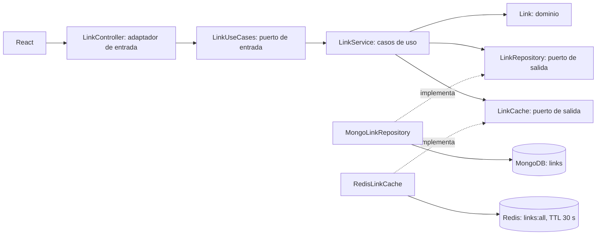
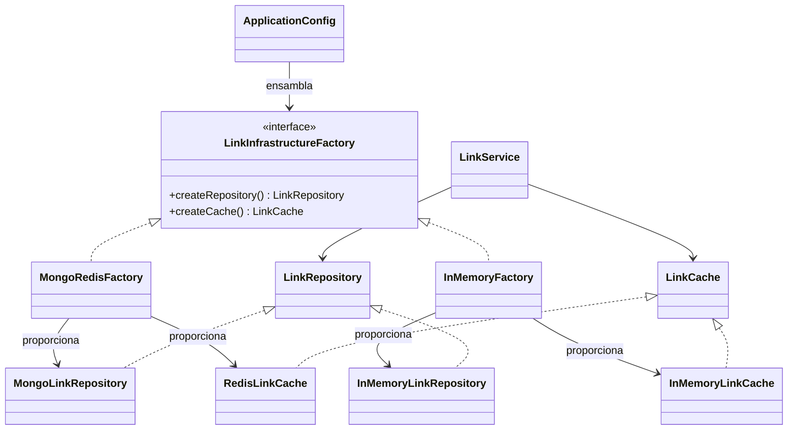

# Acortador de enlaces · Programación Avanzada

Proyecto académico funcional con Java 21, Spring Boot, React, MongoDB permanente y Redis como caché del listado por 30 segundos. Sin autenticación, Docker ni servicios de acortamiento externos. El backend valida la sintaxis HTTP/HTTPS; no descarga el contenido del destino.

## Inicio rápido en Windows

Requisitos: Java 21, Node.js >=22.12, MongoDB en localhost:27017 y Redis en localhost:6379. Maven se descarga automáticamente en `.tools` la primera vez, con verificación SHA512 desde Maven Central; requiere Internet para obtener herramientas y dependencias.

Los servicios `MongoDB` y `Redis` ya estaban instalados y en ejecución en el equipo al desarrollar el proyecto. Para comprobarlos:

```powershell
Get-Service MongoDB,Redis
mongosh --quiet --eval 'db.runCommand({ ping: 1 })'
redis-cli ping
```

Si están detenidos, puedes iniciarlos desde Servicios de Windows o con `Start-Service MongoDB` y `Start-Service Redis` en una terminal con permisos de administrador. Si tu instalación usa otros nombres, usa los de tu instalación. Redis debe ser un servidor real ya instalado, no un reemplazo implementado por este proyecto. MongoDB conserva sus archivos en su directorio de datos del servicio.

Terminal 1, desde la raíz del proyecto:

```powershell
cd backend
.\mvnw.cmd spring-boot:run
```

Terminal 2, desde la raíz del proyecto:

```powershell
powershell -NoProfile -ExecutionPolicy Bypass -File .\start-frontend.ps1
```

Abre **http://localhost:5173**. Backend: **http://localhost:8080**. Detén cada proceso con Ctrl+C.

El script del frontend copia el código a `$env:TEMP\parcial2-url-shortener\frontend`, instala con `npm ci` cuando cambia el lockfile y ejecuta Vite. Esto evita los errores EBADF/EPERM detectados al instalar `node_modules` directamente en la unidad virtual de Google Drive J:. Los fuentes permanecen aquí; si editas los fuentes en J:, detén Vite y vuelve a ejecutar el script para sincronizarlos. En un disco local normal basta con `cd frontend`, `npm ci`, `npm run dev`.

Para generar la distribución desde J: sin problemas de Google Drive:

```powershell
powershell -NoProfile -ExecutionPolicy Bypass -File .\start-frontend.ps1 -Task build
```

El resultado queda en `$env:TEMP\parcial2-url-shortener\frontend\dist`. No hace falta compilar React para usar el servidor de desarrollo.

## Configuración

`backend/src/main/resources/application.properties` permite estas variables de entorno:

| Variable | Predeterminado |
| --- | --- |
| `MONGODB_URI` | `mongodb://localhost:27017/urlshortener` |
| `REDIS_HOST` | `localhost` |
| `REDIS_PORT` | `6379` |
| `REDIS_PASSWORD` | vacío |
| `PORT` | `8080` |
| `APP_BASE_URL` | `http://localhost:8080` |
| `FRONTEND_ORIGIN` | `http://localhost:5173` |

Si cambias el puerto backend, cambia también `APP_BASE_URL`. Ejemplo en PowerShell, antes de iniciar el backend: `$env:PORT='8081'; $env:APP_BASE_URL='http://localhost:8081'`.

Copia `frontend/.env.example` a `frontend/.env` para cambiar `VITE_API_URL`. Reinicia Vite al modificarlo. No guardes contraseñas en el repositorio. El CORS de la API permite el origen configurado y los métodos GET/POST.

### Compatibilidad verificada

Spring Boot **3.5.16** administra las versiones compatibles de Spring Web, Spring Data MongoDB, Spring Data Redis, Jackson y Lettuce a través de su parent Maven. No se mezclan versiones manuales de estos componentes. Java 21 está dentro del rango soportado y Maven 3.9.9 supera el mínimo 3.6.3: [requisitos oficiales](https://docs.spring.io/spring-boot/3.5/system-requirements.html).

Vite **7.3.7** se resolvió en el lockfile y compiló con Node **22.14.0**, compatible con [los requisitos oficiales de Vite](https://vite.dev/guide/). `package-lock.json` fija la instalación reproducible de React y las demás dependencias.

## Estructura y arquitectura hexagonal

```text
backend/src/main/java/com/example/urlshortener/
  domain/model/Link.java                Entidad independiente
  application/ports/                   Contratos de entrada y salida; fábrica abstracta
  application/service/LinkService.java Casos de uso
  infrastructure/persistence/          Adaptadores MongoDB y memoria
  infrastructure/cache/                Adaptadores Redis y memoria
  infrastructure/factory/              Dos fábricas concretas
  infrastructure/web/controllers/      REST, redirección y errores
  config/ApplicationConfig.java        Composición e inyección Spring
frontend/src/
  services/linkApi.js                   Acceso HTTP centralizado
  components/CopyButton.jsx            Portapapeles y confirmación
  components/CacheTimer.jsx            Contador sincronizado
  App.jsx                              Dos módulos y estados de la interfaz
```



El dominio es un `record` Java inmutable, sin anotaciones MongoDB. Usa `Instant` UTC con precisión de milisegundos, equivalente a la fecha BSON de MongoDB y sin ambigüedad de zona horaria. `LinkDocument` es la representación documental separada. El núcleo (`domain` y `application`) solo importa contratos propios y clases del JDK: no depende de Spring, MongoTemplate, RedisTemplate ni fábricas concretas.

`LinkUseCases` es el puerto de entrada. `LinkRepository` y `LinkCache` son los puertos de salida. Los controladores traducen HTTP a casos de uso y añaden la URL absoluta configurable a las respuestas. MongoDB y Redis quedan detrás de adaptadores.

## Abstract Factory (GoF)

La fábrica abstracta está en **`application/ports/LinkInfrastructureFactory.java`**, como exige el enunciado. Expone `createRepository()` y `createCache()`; ambos devuelven contratos, sin importar clases concretas.



Cada fábrica proporciona una **familia completa de dos productos**. `MongoRedisFactory` reutiliza los adaptadores administrados por Spring; no crea conexiones al solicitar productos. `InMemoryFactory` mantiene sus productos y se utiliza de verdad en `LinkServiceTest` y `LinkControllerTest`, sin MongoDB ni Redis. Los clientes de prueba usan exactamente `LinkService`, sin cambiar su lógica.

`ApplicationConfig.linkUseCases(LinkInfrastructureFactory factory)` llama a los dos métodos de la fábrica y pasa los productos al constructor de `LinkService`. Por tanto, la fábrica participa en el ensamblaje real; no es decorativa. En producción siempre se ensambla la familia MongoDB/Redis. La alternativa en memoria está destinada a pruebas y no se presenta como persistencia permanente.

## Flujos y decisiones

### Crear

1. React envía `originalUrl` al backend.
2. `LinkService.create` valida una URI HTTP/HTTPS con host, sin credenciales ni espacios.
3. Genera siete caracteres alfanuméricos con `SecureRandom` y verifica existencia.
4. Inserta en MongoDB en la colección `links`. Un índice único real protege `shortCode` incluso ante concurrencia. `DuplicateKeyException` se traduce al contrato `DuplicateCodeException` y provoca reintento; máximo diez intentos.
5. Invalida `links:all` para evitar un listado antiguo; la siguiente consulta inicia otro ciclo de caché.
6. El controlador devuelve HTTP 201 con una URL absoluta basada en `APP_BASE_URL`. React muestra y copia esa URL real.

### Listar y TTL

- `LinkService.list` consulta primero `LinkCache`.
- Un acierto devuelve `source=redis`; la lectura Lua de Redis obtiene el valor y `PTTL` de forma atómica, sin renovar el vencimiento.
- Si no existe, consulta MongoDB, guarda JSON en Redis con expiración real de 30 segundos y devuelve `source=mongo` con el TTL consultado en Redis después de guardar.
- Se redondean los milisegundos restantes hacia arriba para mostrar segundos enteros entre 0 y 30.
- También se cachean listas vacías.
- `GET /api/links/cache/status` consulta el TTL y no crea ni renueva la entrada.
- `create` y `list` se sincronizan en una instancia de aplicación para evitar que una lectura concurrente vuelva a cachear el listado anterior durante una creación. La simplicidad académica asume una sola instancia backend, sin despliegue distribuido.

React fija una fecha de vencimiento con el TTL recibido y el instante de inicio de la solicitud, descontando de forma conservadora el tiempo de red. `CacheTimer` recalcula la diferencia contra `Date.now()`, por lo que no acumula retrasos de `setInterval`. El contador es una aproximación visual al segundo, basada en Redis; no reinicia a 30 por renderizar. El hash `#enlaces` conserva el módulo al recargar: consulta nuevamente y recibe el TTL restante de Redis. Al volver a una pestaña visible se consulta solamente `cache/status`.

Al llegar a cero muestra **«Caché expirada»**, conserva la tabla y no vuelve a consultar automáticamente el listado. Al pulsar «Actualizar listado» se reconstruye desde MongoDB si expiró. Crear un enlace invalida la caché y comienza un ciclo nuevo en la siguiente consulta. El contador no aparece al abrir por primera vez el módulo Acortar.

### Redirigir y persistencia

`GET /r/{code}` consulta el repositorio permanente, independientemente de la caché del listado. Devuelve **302** y cabecera `Location`, o **404** si el código no existe. `Cache-Control: no-store` evita que el navegador oculte cambios de TTL en consultas y redirecciones.

No hay TTL ni eliminación automática en MongoDB; expirar o reiniciar Redis no elimina documentos. Reiniciar Spring Boot reutiliza los datos guardados en MongoDB. La lista caché solo vive en Redis. El backend no hace peticiones al destino: la navegación ocurre en el navegador al abrir el enlace.

Los errores de validación producen 400 y los fallos de acceso a los servidores, 503 con un mensaje comprensible. MongoDB debe estar disponible al arrancar para garantizar la creación del índice único. Redis debe estar disponible para crear/invalidate y consultar el listado. Si Redis falla justo después de insertar un enlace, el documento ya está persistido aunque la solicitud informe un error; se puede recuperar cuando vuelva el servicio. No se incorpora una transacción distribuida al ejercicio.

## API

| Método | Ruta | Resultado |
| --- | --- | --- |
| POST | `/api/links` | 201, enlace creado y URL absoluta |
| GET | `/api/links` | 200, `links` y `cache: {source, ttlSeconds, active}` |
| GET | `/api/links/cache/status` | Estado Redis sin reconstruir caché |
| GET | `/r/{shortCode}` | 302 al original o 404 |

Ejemplo PowerShell:

```powershell
$body = @{originalUrl='https://example.com/una/ruta?consulta=parcial'} | ConvertTo-Json
$link = Invoke-RestMethod http://localhost:8080/api/links -Method Post -ContentType 'application/json' -Body $body
$link
Invoke-RestMethod http://localhost:8080/api/links
Invoke-RestMethod http://localhost:8080/api/links/cache/status
```

Copia `$link.shortUrl` en la barra del navegador para seguir la redirección. El ID mostrado en la tabla corresponde al UUID real de MongoDB (abreviado visualmente, completo al pasar el cursor), no a un consecutivo ficticio.

## Pruebas

Desde `backend`:

```powershell
.\mvnw.cmd test
.\mvnw.cmd test -DlocalIntegration=true
```

La primera ejecuta 15 pruebas unitarias/HTTP y omite explícitamente la integración real. La segunda ejecuta las **16 pruebas**, incluida integración real. Esta última necesita localhost:27017 y localhost:6379 sin autenticación, usa una base aleatoria `urlshortener_test_<uuid>` y clave `links:test:<uuid>`, y limpia exclusivamente sus datos de prueba al terminar. No borra los enlaces de `urlshortener` ni usa `FLUSHDB`. Espera la expiración real de 30 segundos, por eso tarda más.

- `LinkServiceTest`: creación, validación, códigos diferentes, colisiones, conflicto durante inserción, límite de reintentos, resolución, invalidación, TTL y familia en memoria.
- `LinkControllerTest`: URL absoluta, 400, redirección 302, 404, redirección sin caché y metadatos del listado.
- `LocalInfrastructureTest`: familia MongoRedis, índice único real, lectura de datos con otra instancia de servicio/repositorio, TTL 30, acierto Redis sin renovar, expiración real, permanencia en MongoDB y nueva carga.

Para probar el navegador, con ambos servidores iniciados y Chrome instalado, ejecuta desde una copia local del frontend:

```powershell
npm ci
npm run smoke
```

El script de inicio también copia `smoke.mjs`: puedes ejecutar `npm run smoke` directamente en `$env:TEMP\parcial2-url-shortener\frontend`. La prueba crea un enlace de demostración hacia example.com que queda guardado en la base de desarrollo. Comprueba el portapapeles, 302/404 sin visitar el destino, recarga sin renovar TTL, expiración sin perder filas y vista móvil; genera capturas locales. Sus URLs están preparadas para los puertos predeterminados.

Los resultados reales y las limitaciones verificadas se encuentran en [VALIDACION.md](VALIDACION.md).

## Archivos que debo mostrar al docente

Las rutas Java de esta tabla son relativas a `backend/src/main/java/com/example/urlshortener/`.

| Elemento | Archivo y método |
| --- | --- |
| Abstract Factory | `application/ports/LinkInfrastructureFactory.java`: `createRepository`, `createCache` |
| Concrete Factory de producción | `infrastructure/factory/MongoRedisFactory.java`: ambos métodos |
| Concrete Factory alternativa | `infrastructure/factory/InMemoryFactory.java`: ambos métodos; utilizada por pruebas |
| Abstract Products / puertos de salida | `application/ports/LinkRepository.java` y `LinkCache.java` |
| Concrete Products permanentes | `infrastructure/persistence/mongo/MongoLinkRepository.java`: `save`, `findAll`, `findByShortCode` |
| Concrete Product de caché | `infrastructure/cache/redis/RedisLinkCache.java`: `get`, `put`, `remainingSeconds`, `invalidate` |
| Concrete Products alternativos | `infrastructure/persistence/memory/InMemoryLinkRepository.java` y `infrastructure/cache/memory/InMemoryLinkCache.java` |
| ProductService / casos de uso | `application/service/LinkService.java`: `create`, `list`, `resolve` |
| Puerto de entrada | `application/ports/LinkUseCases.java` |
| Dominio independiente | `domain/model/Link.java` |
| Representación documental | `infrastructure/persistence/mongo/LinkDocument.java` |
| Controlador HTTP | `infrastructure/web/controllers/LinkController.java`: `create`, `list`, `status`, `redirect` |
| Ensamblaje real | `config/ApplicationConfig.java`: `infrastructureFactory`, `linkUseCases` |
| Dependencias | `backend/pom.xml`, parent Spring Boot y starters |
| Demostración sin cambiar el servicio | `backend/src/test/java/com/example/urlshortener/LinkServiceTest.java` y `LocalInfrastructureTest.java` |
| Contador sincronizado | `frontend/src/App.jsx`: `load`; `frontend/src/components/CacheTimer.jsx` |

Explicación para sustentar: «El servicio conoce contratos. La fábrica entrega una pareja compatible de repositorio y caché. Spring elige la fábrica MongoRedis y el punto de composición entrega sus productos al servicio. Las pruebas cambian la pareja por memoria sin cambiar los casos de uso. MongoDB conserva el enlace y Redis acelera solo la consulta del listado por 30 segundos».

## Guion breve de demostración

1. Abrir Acortar: no hay contador. Crear una URL HTTP/HTTPS y copiar la respuesta.
2. Pegar la URL corta en el navegador: demostrar la redirección.
3. Abrir Ver enlaces: origen MongoDB, TTL cercano a 30. Volver a consultar: origen Redis y TTL menor.
4. Recargar a mitad del ciclo: el contador conserva aproximadamente el tiempo restante.
5. Esperar cero: la tabla permanece; abrir el enlace corto sigue funcionando.
6. Actualizar listado: vuelve a MongoDB y comienza otro ciclo.
7. Reiniciar el backend y comprobar que el registro permanece.
8. Mostrar la interfaz de fábrica, las dos fábricas, los contratos y `ApplicationConfig.linkUseCases`; ejecutar las pruebas.

No se adjuntaron los dos bocetos como imágenes en esta conversación. La interfaz sigue la distribución textual solicitada: dos módulos, campo y resultado, tabla de cuatro columnas y TTL arriba a la derecha; no se afirma una reproducción exacta de imágenes no disponibles.